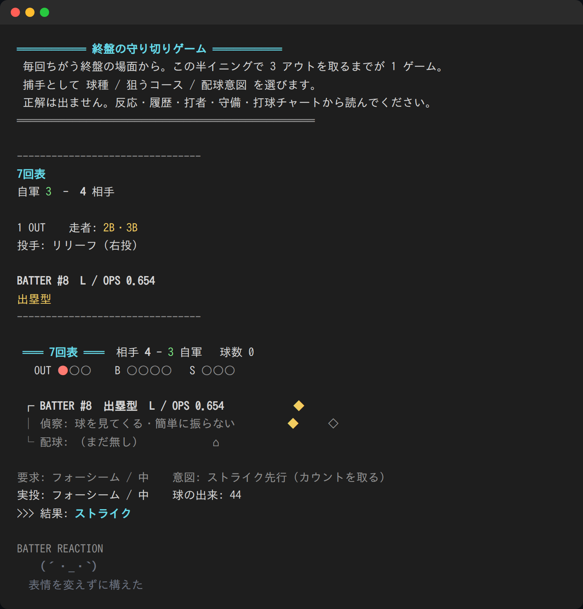
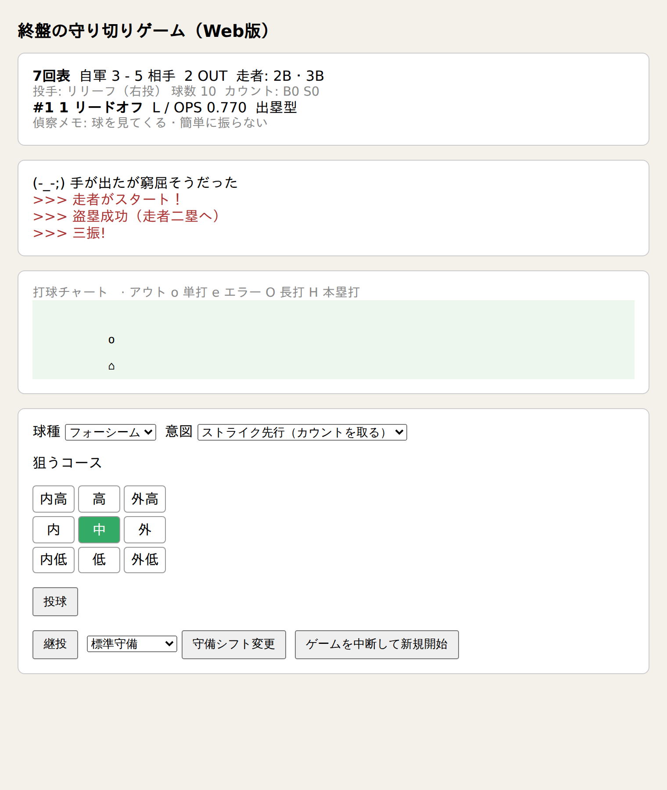
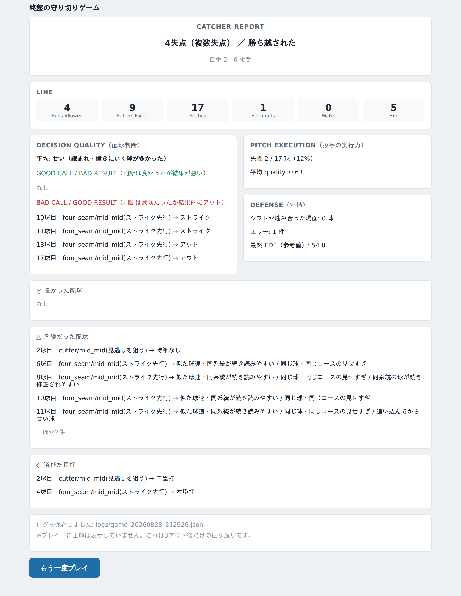

# 配球判断シミュレーター — 終盤の守り切りゲーム

[](https://github.com/tsukinukeeeru2/pitch-calling-simulator/actions/workflows/tests.yml)

> 別のチャット／スマホで続きをやるときは **`HANDOFF.md`** を読めば現状が分かります。


野球の捕手経験をもとにした、**不完全情報のもとで意思決定するゲーム**。
「一番高い確率のボタンを押す」ゲームではありません。

毎回ちがう**終盤の 1 場面**（7〜9 回・延長、表/裏、点差、走者、相手打順）から始まり、
その半イニングで **3 アウトを取るまで**が 1 ゲームです。

捕手として毎球
* **球種** ／ **狙うコース** ／ **配球意図**（ストライク先行・チェイス・打たせて取る・見せ球・見逃し狙い）
を選びます。ただし
* 打者能力・投手能力・**球のコントロール（失投）**・球威・打者の狙い・守備・乱数
も大きく効くので、**捕手だけで結果を 100% は操作できません**。良い配球は「抑える確率が上がる」だけ。

**プレイ中に正解は表示されません。** 打者の顔文字・反応、配球履歴、打者の左右/OPS、守備力から自分で読みます。
振り返り（結果と判断を分けた分析）は**3 アウト後だけ**表示されます。

|  |  |
|---|---|
|  |  |
| CLI 版（`main.py`） | Web 版（`webapp.py`） |


*3 アウト後だけ表示される「結果と判断は別ものとして評価」する振り返り画面。*

```bash
cd pitch-calling-simulator
python main.py                                   # プレイ
python main.py --lineup lineups/sample_team.json # 相手打線を差し替えて（#C）
python tests.py                                  # 自動テスト（最後に 1000 ゲームのストレステスト）
python stats.py                                  # logs/ を集計した成績ダッシュボード
python replay.py                                 # 直近のゲームを名場面だけリプレイ
python webapp.py                                 # ブラウザ版（http://127.0.0.1:8765）
```

`--difficulty beginner`（ヒント表示を追加）/ `--difficulty expert`（打球チャートを隠す）で難易度を選べます（既定 `normal`、`PITCHSIM_DIFFICULTY` でも指定可）。
どの難易度でも隠しパラメータ（狙い球のクセ・weak_course など）自体には一切触れません。

プレイ中の操作: `Enter`=投球 / `d`=守備変更 / `m`=打者の読みをメモ / `w`=敬遠（一塁が空いているとき）/ `p`=継投（1回だけ）/ `q`=終了。
投球は「球種 → コース（3×3 グリッド）→ 配球意図」。
色は自動で付きます（パイプ・リダイレクト時は自動オフ。`PITCHSIM_COLOR=1` で強制オン、`NO_COLOR` で強制オフ）。

---

## ファイル構成

### ゲームロジック（UI に依存しない層）

| ファイル | 役割 |
|---|---|
| `match_state.py` | **`MatchState`**（試合状況）と `generate_random_situation()`（終盤の場面をランダム生成） |
| `lineup.py` | 相手打線 9 人（archetype）／`Lineup`（打順の回転）／CSV・JSON 読み込み口 |
| `pitcher.py` | **`Pitcher`** と `execute_pitch()`（要求 → 実際の投球。失投でコースがズレる） |
| `batter.py` | **`Batter`**（公開: 左右・OPS・タイプ／隠し: 苦手球種・狙い球のクセ 等）と `predict_guess()` |
| `pitch_data.py` | **球種のデータ**。ここに 1 行足すだけで球種が増える |
| `strategy.py` | 配球意図・**セットアップ（前球が次を活かす）**・**Catcher Decision Quality**・試合後分析 |
| `pitch_history.py` | 配球履歴（投げた球を順に記録し、連続数などを答えるだけ） |
| `judge.py` | 1 球の判定。実投球 → 狙い → セットアップ → タイミング → 振る/見る → フェアなら打球＋守備＋走塁 |
| `batted_ball.py` | フェア打球の中身（方向 / 種類 / 強さ / 飛距離）を確率生成 |
| `baserunning.py` | フェア打球後の走塁（長打の進塁・併殺・犠飛・タッチアップ・進塁打）を状態を変えずに解決 |
| `fielders.py` | `Fielder` と **`position_fit`**（同じ選手でもポジションで守備力が変わる） |
| `defense.py` | `Defense`（7 人の割り当て・守備シフト・EDE 参考値） |
| `fielding.py` | 打球＋守備配置 → アウト/ヒット（加算式・内訳つき） |
| `reaction.py` | **打者の反応（顔文字 + 短文 + カテゴリ）**。隠し情報は見ない。確率的にしか本音を出さない |
| `constants.py` | コース・反応確率など共通データ |

### 表示層（差し替えれば GUI 化できる）

| ファイル | 役割 |
|---|---|
| `ansi.py` | 端末の色付けヘルパー（パイプ時は自動で無効） |
| `qte.py` | 送球・ブロッキングのリズム / QTE ミニゲーム（非対話時は自動スキップ） |
| `ballpark_view.py` | 守備位置を「球場を上から見た図」の色付き文字列に |
| `ui.py` | スコアボード・ベース図・打者カード・**打球チャート**・1 球結果・試合後分析 |
| `main.py` | 進行役。入力・`--lineup` 読込・ゲームログ保存・上を呼んで表示 |

### ツール

| ファイル | 役割 |
|---|---|
| `stats.py` | `logs/game_*.json` を横断集計する成績ダッシュボード（コース別/意図別の被弾率・decision_quality） |
| `replay.py` | 1 ゲームのログを名場面だけ時系列で振り返るリプレイビューア（`strategy.build_analysis()` の分類を再利用） |
| `webapp.py` | ブラウザで遊べる軽量 Web UI（標準ライブラリの `http.server` のみ）。`main.resolve_one_pitch()` を再利用し、HTML で組み立て直すだけ |

### データ

| ファイル | 役割 |
|---|---|
| `lineups/sample_team.json` | 差し替え用の架空サンプル打線（`--lineup` で読む） |
| `logs/game_*.json` | 1 ゲームごとに自動保存される試合ログ（#E） |

---

## 1. 打者の反応（顔文字）— `reaction.py`

`describe_reaction()` の戻り値:

```python
{"face": "(・_・;)", "ascii_face": ":-S",
 "text": "一瞬タイミングを取り直した",
 "category": "uncertain", "kind": "reveal"}
```

### 表情カテゴリ（10 個）

`jammed`(差し込まれた) / `out_front`(泳いだ) / `confident`(自信) / `comfortable`(余裕) /
`uncertain`(迷い) / `surprised`(意表) / `frustrated`(苛立ち) / `locked_in`(振り抜いた) /
`defensive`(粘り) / `neutral`(無表情)

### どの状態でどの顔文字が出るか

1. `judge.py` の結果（タイミング・振ったか・見逃し方）から **素直なカテゴリ**を決める
   （late→`jammed` / early→`out_front` / on_time 空振り→`locked_in` / 外の見送り→`comfortable` …）
2. `REACTION_MISLEAD_RATE`（15%）で **逆の印象**カテゴリ（`jammed`↔`confident` など）
3. そうでなければ `REACTION_REVEAL_RATE`（60%）で素直なカテゴリ
4. 残り 25% は情報の薄いカテゴリ（`neutral` / `uncertain` / `frustrated`）
5. 選ばれたカテゴリから、**顔文字と文をそれぞれランダムに**選ぶ（各カテゴリに 3 つずつ）

→ 同じ内部状態でも顔文字は毎回変わり、ミスリードとぼかしが混ざるので、
**顔文字だけで内部状態は特定できません**（テスト `test_face_not_deterministic_for_state` で検証）。

### ASCII フォールバック

`render_reaction_block()` は、`sys.stdout` が非 ASCII を出せなさそうなら
自動で `ascii_face`（`>_<` `:-)` `:-S` など純 ASCII）に切り替えます。`ascii_only=True` で強制も可能。
文（日本語）はそのまま、顔文字の行だけ ASCII になります。

---

## 2. 試合状況の生成 — `match_state.generate_random_situation()`

| 項目 | 生成方法 |
|---|---|
| イニング | 7 / 8 / 9 / 延長10 を重み [3,3,3,1] |
| 表 / 裏 | ランダム（守備側はつねに自軍。表=自軍HOME / 裏=自軍AWAY） |
| 点差（自軍−相手） | -3〜+3 を重み [1,2,4,5,4,2,1] → **-1 / 0 / +1 の接戦が出やすい** |
| アウト | 0 / 1 / 2 を重み [5,3,2] |
| 走者 | 各塁 独立に約 30〜38% |
| 開始打順 | 1〜9 番からランダム。以降 8→9→1→2… と通常どおり回る |

3 アウトで終了し、`result_summary()` が
**無失点 / 1失点 / 複数失点** と **リード維持 / 同点に追いつかれた / 逆転された** 等をまとめます。

---

## 3. 相手打線 9 人 — `lineup.py`

`SAMPLE_LINEUP` に 9 人の「中心値」があり、`build_sample_lineup()` が
archetype 内で少し乱数を振って毎回わずかに違う 9 人を作ります。

| 打順 | タイプ | 特徴（設計値の傾向） |
|---|---|---|
| 1 | 出塁型 | 高 OBP・高 discipline・低 power・低 chase・俊足 |
| 2 | コンタクト型 | 高 contact・低 whiff・低 power |
| 3 | 総合型 | すべて高水準・左打 |
| 4 | 強打者 | 高 power・引っ張り・やや高 whiff・内角が得意 |
| 5 | 長打型 | 最高 power・低 contact・高 whiff・強い引っ張り |
| 6 | フリースインガー | 高 chase・高 whiff・低 discipline・早いカウントから振る |
| 7 | 平均的 | すべてリーグ平均 |
| 8 | 低OPSだが選球眼 | 低 power/slg・高 discipline・低 chase |
| 9 | 俊足弱打 | 攻撃力は低いが `speed` が高く、内野ゴロを内野安打にしうる |

**公開されるのは** 名前・左右・OPS・打者タイプ・（タイプ由来の）偵察メモだけ。
`weak_pitch` / `hot_course` / `guess_bias`（狙い球のクセ）などは**隠し**です。

将来の実データ差し替え: `Lineup.from_records([dict, ...])` / `load_lineup_file("team.json"|".csv")`。
選手 1 人を `Batter.__init__` と同じキーの dict にすれば、侍ジャパンや MLB 打線を読み込めます。

---

## 4. 狙い球ロジック — `Batter.predict_guess()`（隠し）

戻り値: `{"class": "fastball"|"offspeed", "class_strength": 0..1, "location": ..., "loc_strength": 0..1}`

速球待ちの強さ `lean_fastball` を次で動かします。

* 打者ごとの隠しクセ `guess_bias`
* **配球履歴**：直近 4 球で多く見せた側に張る（履歴がなければ投手の持ち球の速球比率）
* **打席をまたぐ記憶**（打者一巡）：`MatchState.batter_pitch_memory` に打席ごとの球種傾向が残り、
  同じ打者と再戦したとき薄く（25%）反映される。`next_batter()` が打者交代のたびに記録する
* **カウント**：打者有利（ボール先行）→ 速球狙い ／ 2 ストライク → 絞りきれない
* **同じ球種の連続**：3 連続などで、その系統に強く張る（＝外せば大きな空振り）
* **前の球**：速球を見逃しストライクで取られた直後は、変化球を意識しやすい
* discipline が低いほど「決め打ち」しやすい（strength を持ち上げる）

読みが当たると打者は**振りやすく・強く**なり、外すと**止まりやすく・打ち損じやすく**なります。

---

## 5. Pitch Execution（実投球）— `pitcher.execute_pitch()`

```
Pitch Call（要求）→ execute_pitch() → Actual Pitch（実際）→ Batter Reaction
```

* コースを外す確率 `miss_p` は `control` / `command` が高いほど下がる。
  隅を狙う＋きわどい意図（chase/freeze/weak_contact）ほど上がる。見せ球（waste）は下がる。
* 外した場合、隅狙いは **65% で真ん中に甘く入る（leak）**、残りは隣のコースへ散る。
* `quality`（球の出来 0〜1）は `pitch_quality[球種]` を土台に velocity と乱数で上下。失投だと下がりがち（でも必ずではない）。

→ **良い配球でも失投（actual=真ん中）すれば打たれる。悪い配球でも quality が高ければ抑える。**
`quality` と `actual_course` は `decision_quality` とは独立に結果へ効きます。

---

## 6. セットアップ（前球が次を活かす）— `strategy.evaluate_sequencing()`

「この配球で +20%」のような固定ボーナスは**作っていません**。
小さなルール（各 ±0.02〜0.06）が、**条件が揃ったときだけ**発火し、合計も `±0.15` に clamp されます。

主なルール（条件 → 効果 + メモ）:

| 条件 | 効果 |
|---|---|
| 初球・直球待ちの打者に変化球でストライク | 空振り+ / 打ち損じ+ |
| 低め見せた次に高め速球（釣り球） | 空振り+ / タイミング崩し |
| 高め見せた次に低め変化球 | 空振り+ / 打球弱く |
| 前球との**球速差が大きい**（≥8mph）、さらに球種も違う | タイミング崩し+ |
| 前球と**球速差が小さく同系統** | 打たれやすく（読みやすい）− |
| 内 ↔ 外の大きな揺さぶり | 見送り+ / 空振り+ |
| ストレート → チェンジアップ | 空振り+ / early 誘発 |
| ゾーンの変化球 → ボールゾーンの変化球 | 空振り+（chase） |
| 差し込まれている打者へインコース速球 | 空振り+ / 打球弱く |
| 泳いでいる打者へ変化球・外の球 | 空振り+ |
| 右投手 vs 左打者 に逃げる球 | 打球弱く |
| **同じ（球種・コース）を打席内で繰り返し** | 空振り− / 打たれやすく− |
| 同系統 3 連続以上 | 打たれやすく− |
| 追い込んでから真ん中 | 打たれやすく−（大きめ） |

これらは `judge.py` の `whiff_chance` / `swing_chance` / `contact_bias` / タイミングに足されます。

---

## 7. Catcher Decision Quality（内部指標）— `strategy.catcher_decision_quality()`

**プレイ中は絶対に表示しません**（テスト `test_decision_quality_hidden_from_live_ui` で検証）。
-1〜+1 のスコアで、次を加算:

* 打者の狙い（速球/変化球）を**外せたか**（±0.30 × 狙いの強さ）
* 実際のコースが打者の **weak_course なら +0.20 / hot_course なら −0.25 / 真ん中 −0.12**
* タイミングを崩せたか +0.15
* 同系統の見せすぎ −0.15
* 配球意図とカウントの相性（chase を 2 ストライクで +0.15 / 3 ボールで −0.25 など）
* セットアップの process（whiff を稼ぎ、強い打球を減らす配球ほど +）
* 守備シフトと打者の引っ張り度の相性 ±0.05

**この値は結果を決めません。** 最終結果は判定チェーンの独立した確率抽選です。

---

## 8. 結果と判断の分離 — `strategy.build_analysis()`（3 アウト後だけ）

各球を `(decision_quality, result)` で分類します。

* `decision_quality ≥ +0.25` かつ 結果が **ヒット/四球** → **「判断は良かったが結果が悪い（不運）」**
* `decision_quality ≤ −0.25` かつ 結果が **アウト/空振り/見逃しストライク** → **「判断は悪いが結果に救われた（幸運）」**
* 良かった配球 / 危険だった配球 / 狙いを外せた場面 / 読まれていた場面 /
  守備と噛み合った場面 / 失投で結果が悪化した場面 も集計

「良い配球でもホームランはあるし、悪い配球でもアウトはある」— その区別を見せます。

---

## 長打と走塁（改良A）— `fielding._hit_extent()` ＋ `baserunning.resolve()`

安打になったら `fielding._hit_extent()` が **単打 / 二塁打 / 三塁打 / 本塁打** を決める:

| 打球 | なりやすい安打 |
|---|---|
| 強い・深い・フライ/ライナー（引っ張り） | 本塁打（打者 power で確率上昇） |
| 深いギャップ + 俊足 | 三塁打 |
| 深い打球 / 浅いライナー / 三塁線を破る強いゴロ | 二塁打 |
| それ以外 | 単打 |

`baserunning.resolve()` が走塁を解決（`judge.py` が状態を変えずに呼び、`MatchState.apply_play()` が反映）:

* **単打**：三塁走者は生還、二塁走者は外野前なら約65%生還、一塁走者は約35%で三塁へ（内野安打なら station-to-station）
* **二塁打／三塁打**：走者一掃、打者は 2B／3B
* **本塁打**：全員生還
* **エラー**：`fielding.resolve_batted_ball()` がアウトになるはずの打球で確率抽選（`_error_chance`）。
  野手の総合力・ポジション適性が高いほど下がり、強い打球ほど上がる。発生したら単打と同じ扱いで打者・走者が進む（打球チャートでは `e`）
* **併殺**：一塁に走者 & 2アウト未満 & 内野ゴロ → 打者の `speed` が遅く・打球が中くらいなほど成立しやすい（+2アウト）
* **犠飛**：三塁走者 & 2アウト未満 & フライアウト → 深ければ約85%生還。深い犠飛は二塁走者もタッチアップ
* **進塁打**：内野ゴロアウトで約45%、走者が1つ進む（三塁走者は生還）
* このプレーで **3アウト目が成立するなら得点は数えない**（簡略化）

守備シフト「ゲッツー重視」「長打警戒」がここで初めて意味を持ちます。
（テスト `BaserunningTests` 6 件で HR条件・満塁二塁打・併殺・犠飛・3アウト時無得点・単打の進塁を検証）

ランダムプレイでの目安: **1半イニングあたり約 0.75 失点**（改良前は約 0.2）、長打は安打の約 2 割。

## 改良B/C/D/E（ビジュアルと周辺機能）

### B. 読みを助ける／採点する
* **打球チャート**（`ui.render_spray`）: フェア打球がゲーム中に小さな球場図へ**溜まっていく**。
  `·`アウト `o`単打 `O`長打 `H`本塁打、左右は打者の左右を考慮した実方向、前後は飛距離。
  最初は情報ゼロ、イニングが進むほど相手打線の傾向が見えてくる。
* **捕手メモ**（`m` キー → `MatchState.record_read`）: 打者ごとに「待ち球」「弱そうなコース」を記録。
  試合後 `strategy.grade_reads()` が**隠しの真実（`guess_bias` / `weak_course`）と照合**して ◎×採点。

### C. 実データ経路
* `python main.py --lineup lineups/sample_team.json` で相手打線を差し替え（`.json` / `.csv`）。
* `Lineup.from_records()` は `Batter.__init__` が知るキーだけ拾う（`_note` 等の余分な列は無視）。9 人ちょうどでなければエラー。
* MLB Stats API / Savant のスラッシュ・Chase%・Pull% 等を同じキー名の dict にして渡せば実在打線になる。

### 9 分割ゾーン（コースを 3×3 に）
* `COURSES` が 5 → **9 セル**（`in_hi`〜`out_lo`）。`constants.zone_x/zone_y/is_corner/zone_overlap`。
* 隅（横も縦も端）ほど `strike_rate` が低く、失投で `mid_mid` に甘く入りやすい（`pitcher.execute_pitch`）。
* 打者の `hot_course` / `weak_course` は **`zone_overlap` で部分一致**も効く（「外角低めが苦手」なら「外角」でもいくらか差し込める）。
* コース選択は 3×3 のグリッド入力（`main.choose_course`）。読みメモの「弱点コース」もグリッドで、採点は完全一致=◎ / 同じ列か段=△ / それ以外=×。

### ゲーム性の追加要素（終盤らしい駆け引き）
* **敬遠**（`w`）: 一塁が空いていて危険打者のとき、歩かせて次打者勝負。押し出しや満塁のリスクと引き換え。
* **継投**（`p`）: 控え投手に交代（1 ゲーム 1 回）。球数リセットで疲労が消えるが、**新しい投手の持ち球・調子は投げるまで分からない**。
* **盗塁**（`MatchState.steal_chance` → `resolve_steal`）: 一塁走者だけ・二塁が空いていて、打球が飛ばなかった球（見送り・空振り）でたまに走ってくる。
  速球は刺しやすく（`safe_p -= 0.12`）、変化球・ワンバウンドは間に合わない（`+0.10`）。刺せばアウト、成功で走者二塁。
* **振り逃げ**（`MatchState.dropped_third_eligible` → `resolve_dropped_third`）: 一塁が空いている、または 2 アウトのときだけ成立（公式ルールどおり）。
  ワンバウンドの三振（`空振り` かつ実投が失投）で発生しうる。まず捕手が完全に後逸するか（`resolve_block` と同じ式）を判定し、
  後逸なら打者は無条件で一塁へ・ほかの走者も 1 つ進む。後逸でなければ捕手は拾えているので一塁へ送球（QTE）、
  打者の脚力と送球のうまさで生死が決まる。セーフなら強制進塁のみ（`advance_on_walk` と同じ考え方）。

### リズム / QTE（`qte.py`）— 捕手の“体で覚える”プレー
野球は打者も捕手もリズム。**送球とブロッキングをリズムゲームの操作**にした（標準ライブラリのみ、時刻計測 + `input()`）。
端末が対話的でない（パイプ）・`PITCHSIM_QTE=0` のときは自動スキップし確率モデルに任せる（テスト・デモを壊さない）。`PITCHSIM_QTE=1` で強制。

| プレー | 操作 | 採点 |
|---|---|---|
| **盗塁を刺す** | ① スタートに気づいたら即 Enter（反応時間）／② グラブから握り替え＝キー連打（数と時間）／③ 二塁へ送球＝リズムに合わせて Enter | 3 つの perfect/good/miss を合計 → `throw_bonus`（-0.25〜+0.25）。大きいほど刺せる |
| **ブロッキング** | 走者がいて投球が失投したとき（低め暴投は必ず／他の失投も時々）。① `1=内 2=中 3=外` で**ボールが来た方向**へ入る（隣なら GOOD、逆は MISS）／② `▶ 1 ▶ 2 ▶ 3` の一定テンポで即 Enter | 方向＋3拍のリズム → `block_bonus`（-0.25〜+0.25）。隅への低め（`hard`）は元々止めにくい |
| **振り逃げの一塁送球** | ワンバウンド三振で捕手が拾えたとき（後逸しなかったとき）だけ発生。`catcher_throw(base="一塁")` を再利用（盗塁の二塁送球と同じ 3 段階、送球先の表示だけ変わる） | 3 つの perfect/good/miss を合計 → `throw_bonus`。大きいほど一塁で刺せる |
| **サイン交換** | 二塁に走者がいるとき、打席の途中でまれに発生。① 指を素早く動かしてサインを変える＝キー連打／② 新しいサインで合図し直す＝素早く Enter | 2 つの perfect/good/miss を合計 → `sign_bonus`。守り切れないと次の1球だけ打者の狙いが実際の球種に強く一致する（`state.sign_leak`） |

`throw_bonus` / `block_bonus` は**結果を確定させず**、`resolve_steal` / `resolve_block` の成功確率をずらすだけ。
下手でも刺せることはあるし、上手くても抜けることはある（走者の足・球種・乱数が効く）。

### D. 投手の疲労
* `Pitcher.pitches_thrown` が増えると `fatigue()` が 0→0.12（16 球あたりから）。
  失投率が上がり、球の出来（quality）が落ちる。スコアボードに `球数` と `⚠疲れ/⚠⚠バテ`。
* 「球数がかさむほど制球がほつれる」＝相手に球数を投げさせる／させないの駆け引きが生まれる。

### E. ゲームログ
* 3 アウト後に `logs/game_YYYYmmdd_HHMMSS.json` を自動保存
  （場面・全投球・decision_quality・打球・読みの採点・最終結果）。セッション間の振り返り用。
* （`@dataclass` 化は「振る舞いを変えない大量の書き換え」なので今回は見送り。現状のクラスも十分素朴）

### 色（`ansi.py`）
`sys.stdout.isatty()` で自動判定。パイプ・`NO_COLOR`・`TERM=dumb` で無効、`PITCHSIM_COLOR=1` で強制有効。
アウト＝緑 / 安打＝赤 / ボール＝黄 / ストライク＝シアン、顔文字はカテゴリ別の色、弱い野手は赤。

### F. Web UI（`webapp.py`）
`python webapp.py` でブラウザ版が起動します（`http://127.0.0.1:8765`、`--port` で変更可）。

* **標準ライブラリの `http.server` のみ**（Flask 等を追加インストールしない）。ゲームロジックは
  `main.resolve_one_pitch()` をそのまま再利用し、ANSI の代わりに HTML を組み立てるだけ ―
  「表示層を差し替えれば GUI 化できる」という元々の設計方針そのもの。
* 1 リクエスト = フォーム送信（球種・コース・意図をまとめて選んで「投球」）。ページ全体を素の HTML/CSS
  だけで組んでおり、JavaScript は使っていない。
* QTE（リズムミニゲーム）は HTTP のリクエスト/レスポンスでは体で覚える系の入力ができないため、
  `webapp.py` は起動時に `PITCHSIM_QTE=0` を強制し、常に確率モデルに任せる。
* **CLI 版との差分**：守備の選手入れ替え（Swap）と捕手メモ（読みの記録・採点）は未対応。
  守備シフトの変更・敬遠・継投・打球チャートはブラウザ版でも操作できる。

## 守備確率（前バージョンから）— `fielding.resolve_batted_ball()`

```
out_probability = base_out_probability          打球種類×飛距離ごとの素の値
                + defender_skill_adjustment     (総合力-50)/100 * 0.7
                + position_fit_adjustment       (適性-総合力)/100      配置の良し悪し
                + defensive_alignment_adjustment シフトが打球方向と噛み合えば + / 逆なら -
                + batted_ball_adjustment        soft +0.10 / medium -0.02 / hard -0.13
                + runner_speed                  俊足打者の内野ゴロ内野安打
```

`position_fit` は `50 + (raw-50) * difficulty_gain`。SS=1.35 … 1B=0.75 で、
**難しいポジションほど下手さ・上手さが増幅**。EDE の重み `ball_share` は SS が最大。
→「上手い選手を SS・2B に」「穴の選手は 1B や打球が来にくい側の外野に隠す」が成立。
右打者の引っ張り＝レフト方向なので、右の引っ張り屋には穴を RF 側へ（左打者は逆）。

守備メニュー（`main.py` の `d`）: select→select→**Swap**、守備シフト選択、
**Expected Defensive Efficiency（参考値）** 表示（「最適解ではない」と明記）。

守備シフトは 7 種類（標準／引っ張り警戒／逆方向警戒／前進守備／長打警戒／ゲッツー重視／**バント警戒**）。
バント警戒は一塁・三塁が前に出る想定で、`defense.alignment_out_adjust()` が弱い打球（`soft`）はアウトにしやすく、
強い打球（`hard`）はかえって弱くする（構え直す時間がない）。

---

## 球種の追加 — `pitch_data.PITCH_LIBRARY` に 1 エントリ

```python
"gyroball": {
    "name": "ジャイロボール", "pitch_class": "breaking",   # fastball/breaking/offspeed
    "velocity": 88, "movement": 5,
    "whiff_rate": 0.24, "groundball_rate": 0.40, "contact_quality": 0.42,
    "platoon": {"same": -0.08, "opposite": 0.04},
},
```

投手の持ち球は `Pitcher(repertoire=[...])`。`judge.py` は `get_pitch(key)` で数値を読むだけなので if 文は増えません。

---

## 将来 MLB / Statcast データに置き換える

| 置き換えたいもの | 場所 | 方法 |
|---|---|---|
| 球種別 Whiff% / GB% / 球速 / platoon split | `pitch_data.PITCH_LIBRARY` | Statcast の球種別集計で数値を上書き |
| 打者の左右・Chase%・Whiff%・Pull%・球種別成績・スラッシュ | `lineup.SAMPLE_LINEUP` → `Lineup.from_records()` / `load_lineup_file()` | MLB Stats API / Savant の値を dict にして渡す |
| 投手の Control / Velocity / Stuff / 球種 Quality | `pitcher.build_sample_pitcher()` | Statcast（球速・回転・命中率）をマッピング |
| 守備能力（OAA / arm / jump） | `fielders.make_default_fielders()` | 5 能力にマッピング |

`judge.py` / `batted_ball.py` / `fielding.py` / `strategy.py` は**キーと数値の形が同じなら無改修**です。

---

## 現在の割り切り（意図的な簡略化）

* 1 プレイ = 1 つの半イニング（3 アウトまで）。自軍の攻撃（打撃）は実装なし、次のイニングをまたぐ記憶もなし
* 走塁: 長打・併殺・犠飛・進塁打・盗塁・振り逃げ・エラー進塁まで入ったが、**本塁での憤死・中継プレー・犠打/エンドランは未実装**。
  3アウト目が成立するプレーの得点は数えない簡略化
* 守備は「最初に触る 1 人」で判定
* 打者交代はなし（相手打線 9 人は固定）。守備配置の変更はいつでも可（メニュー `d`）

## 数値バランスの調整場所

球種=`pitch_data.py` / 打線=`lineup.py` / 投手=`pitcher.py` / 場面生成=`match_state.py` /
配球意図・セットアップ・判断の質=`strategy.py` / 反応と顔文字=`reaction.py` /
守備=`fielders.py`・`defense.py`・`fielding.py` / 打球=`batted_ball.py`
